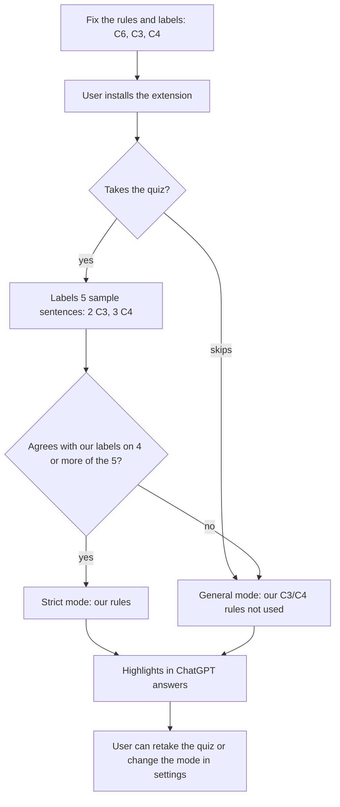

# C3/C4 user calibration: plan

**Status:** proposal by Gideon. Changed on 2026-11-16: **5 questions** (10 was too long before using
an extension), **one mode for both C3 and C4**, and only two modes: strict (our rules) or general
(quiz skipped, or answered differently from us). First version built: the quiz is
`extension/calibration.js`, the modes are in `gisun/criteria.py` (`GENERAL_GUIDANCE`, `guidance()`)
and `gisun/scoring.py` (C3 + C4 count once in general mode).

C3 (loaded language) and C4 (overgeneralization) are the most subjective GiSuN criteria. Even we,
the people who wrote the rules, disagree with them on some sentences. So instead of forcing our
rules on every user, GiSuN first asks each user to label a few sample sentences. Their answers
decide how C3 and C4 are shown to them.

C1, C2, C5 and C6 do not change: they always use our rules.

## Overview

## Step 0: fix the rules and labels first

Calibration only works if "our rules" and "our labels" say the same thing. Today they don't (see
the Nov 10 review: on our 184 rows C3 and C4 caught 0 problems, mostly because the labels and the
rules disagree).

1. **C6:** review the rules and the labels together, sentence by sentence, until they agree. C6
   stays a normal criterion. Start with the 13 false alarms and 2 misses from the Nov 10 run.
2. **C3 and C4:** finalize our rules (the candidates picked on Nov 10 are Rules 1, 2, 5 and 6:
   strong emotional words, loaded headings, "never/ever" beside a hedge, claims about whole
   groups). Then relabel our gold rows so they follow those rules. This becomes **strict mode**.
3. Update [labeling_rules.md](labeling_rules.md) and `gisun/criteria.py` together, as now.

## Step 1: the quiz

Shown once, before the user's first ChatGPT answer is checked. It can sit next to the existing
access question in `extension/gate.js`.

- **5 sentences: 2 for C3 and 3 for C4**, all with one question: "Does this sentence use unfair,
  loaded wording or make a sweeping generalization?", with the answers *Yes*, *No*, *Not sure*.
- **Mix the answers:** 3 sentences we labeled `met` and 2 we labeled `not_met`. A user who answers
  "Yes" to everything must not look like they agree with us.

| # | Sentence | Criterion | Our label |
|---|---|---|---|
| 1 | The senator's reckless plan would gut funding for public schools. | C3 | met |
| 2 | The 2010 earthquake devastated Port-au-Prince, killing more than 200,000 people. | C3 | not_met |
| 3 | Teenagers today can't focus on anything for more than a few minutes. | C4 | met |
| 4 | Exercise usually improves sleep, though not for everyone. | C4 | not_met |
| 5 | People from big cities are rude to strangers. | C4 | met |
- **New sentences only.** Don't reuse sentences from our test sets (`datasets/gold_*.json`), or
  those tests stop being fair.
- **Our labels are stored with the sentences** in the extension, for example in a small
  `extension/calibration.js` list: sentence, criterion, our label, a one-line reason.
- After the quiz, show the user our label and reason for each sentence they answered differently,
  so they learn how GiSuN judges these criteria.

## Step 2: choosing the mode (one mode for C3 and C4)

With only 5 questions, C3 and C4 are scored **together**: 2 or 3 questions per criterion are too
few to tell agreement from luck.

| Quiz result | Mode |
|---|---|
| Matches our label on 4 or 5 of the 5 sentences | **Strict**: our rules |
| Matches on 3 or fewer ("Not sure" is not a match), or **skips the quiz** | **General**: our C3/C4 rules are not used |

## Step 3: what each mode does

**Strict mode** (our rules, as now)
- C3 and C4 are separate, each with its own name and reason: "Loaded wording", "Sweeping
  generalization".

**General mode** (the user reads these sentences differently from us, or didn't tell us)
- C3 and C4 are one flag: *"Worth checking: this sentence may be slanted or too sweeping."* The
  model's reason follows.
- The agents use **looser C3/C4 rules** (`GENERAL_GUIDANCE` in `gisun/criteria.py`): no "When in
  doubt, decide not_met", and strong-but-accurate words, praise words and loaded headings count.
  Reported viewpoints are still never flagged.
- In the risk score, C3 and C4 together count as one problem (the larger of the two scores).

## Step 4: settings

- **Skip:** the user can skip the quiz. They then get general mode.
- **Retake:** "Retake the C3/C4 quiz" in the extension settings. Until there is a settings page:
  `chrome.storage.local.remove("c34QuizDone")` in the extension's service worker console.
- **Change the mode by hand:** strict or general, at any time (needs a settings page).

## Step 5: storage and privacy

- The quiz answers and the chosen modes stay **in the user's own browser**
  (`chrome.storage.local`), the same way `gate.js` remembers `isPassed`. Nothing is sent to us.
- The extension sends only the mode with each request, so the backend knows which C3/C4 rules to
  use (`"c34_mode": "strict"` or `"general"`). It never sends the user's answers.
- **For research:** if we want to collect quiz answers (for example to measure how much people
  disagree about loaded language), it must be opt-in with a clear consent screen, and we should
  check with Hamilton's research ethics board (IRB) first.

## Step 6: testing

- **Strict mode:** tested as now, on `datasets/gold_answers.json`, the public sets and the C4
  200-item set.
- **General mode:** needs its own labels. A sentence is `met` if either of us thinks it *could* be
  loaded language or an overgeneralization. Measure it the same way (precision and recall).
- **The quiz:** try it on about 10 people before release. Check that the sentences are clear, how
  many users land in each mode, and that the 4-out-of-5 cutoff makes sense.

## Work plan

| # | Task | Who | Depends on |
|---|---|---|---|
| 1 | C6: review rules and labels until they agree, rerun | Gideon, Suning | none |
| 2 | C3/C4: finalize strict rules, relabel gold rows, rerun | Gideon, Suning | none |
| 3 | Write the 10 quiz sentences with our labels and reasons | Gideon, Suning | 2 |
| 4 | Label a test set for the general-mode rules | Gideon, Suning | 2 |
| 5 | Backend: accept a mode per criterion and use the matching rules | | 4 |
| 6 | Extension: quiz screen, mode choice, settings, combined message | | 3, 5 |
| 7 | Pilot the quiz with about 10 people, adjust the cutoff | | 6 |

## Open questions

- Decided: 5 sentences, one mode for both criteria.
- Decided: users who skip get general mode.
