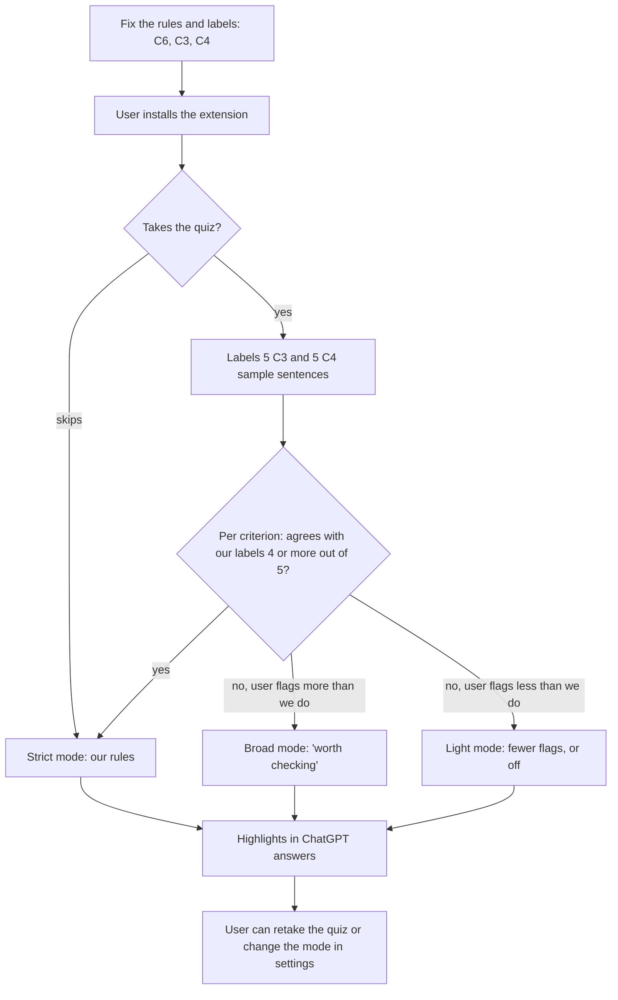

# C3/C4 user calibration: plan

**Status:** proposal by Gideon.

C3 (loaded language) and C4 (overgeneralization) are the most subjective GiSuN criteria. Even we,
the people who wrote the rules, disagree with them on some sentences. So instead of forcing our
rules on every user, GiSuN first asks each user to label a few sample sentences. Their answers
decide how C3 and C4 are shown to them.

C1, C2, C5 and C6 do not change: they always use our rules.

## Overview

## Step 0: fix the rules and labels first

Calibration only works if "our rules" and "our labels" say the same thing. Today they don't (see
the Nov 10 review: on our 184 rows C3 and C4 caught 0 problems, mostly because the labels and the
rules disagree).

1. **C6:** review the rules and the labels together, sentence by sentence, until they agree. C6
   stays a normal criterion. Start with the 13 false alarms and 2 misses from the Nov 10 run.
2. **C3 and C4:** finalize our rules (the candidates picked on Nov 10 are Rules 1, 2, 5 and 6:
   strong emotional words, loaded headings, "never/ever" beside a hedge, claims about whole
   groups). Then relabel our gold rows so they follow those rules. This becomes **strict mode**.
3. Update [labeling_rules.md](labeling_rules.md) and `gisun/criteria.py` together, as now.

## Step 1: the quiz

Shown once, before the user's first ChatGPT answer is checked. It can sit next to the existing
access question in `extension/gate.js`.

- **10 sentences: 5 for C3 and 5 for C4.** For each: "Does this sentence use loaded language?" or
  "Is this sentence an overgeneralization?", with the answers *Yes*, *No*, *Not sure*.
- **Mix the answers:** in each set of 5, 3 sentences we labeled `met` and 2 we labeled `not_met`. A
  user who answers "Yes" to everything must not look like they agree with us.
- **New sentences only.** Don't reuse sentences from our test sets (`datasets/gold_*.json`), or
  those tests stop being fair.
- **Our labels are stored with the sentences** in the extension, for example in a small
  `extension/calibration.js` list: sentence, criterion, our label, a one-line reason.
- After the quiz, show the user our label and reason for each sentence they answered differently,
  so they learn how GiSuN judges these criteria.

## Step 2: choosing the mode (per criterion)

C3 and C4 are scored **separately**. A user can agree with us on C4 but not on C3.

| Quiz result for this criterion | Mode |
|---|---|
| Matches our label on 4 or 5 of the 5 sentences | **Strict**: our rules |
| Fewer than 4, and most differences are "Yes" where we said `not_met` (the user is stricter than us) | **Broad**: "worth checking" |
| Fewer than 4, and most differences are "No" where we said `met` (the user is looser than us) | **Light**: fewer flags, or off |
| Fewer than 4, differences go both ways | **Broad** |

"Not sure" counts as neither a match nor a difference. If a user answers "Not sure" to 3 or more of
the 5, they get strict mode.

## Step 3: what each mode does

**Strict mode** (our rules, as now)
- C3 and C4 are separate, each with its own name and reason: "Loaded wording", "Sweeping
  generalization".

**Broad mode** ("worth checking")
- C3 and C4 are combined into one softer flag. Any sentence the model thinks *might* be loaded or
  overgeneralized is highlighted.
- Message: *"Worth checking: we think this sentence could use loaded language or be an
  overgeneralization."* The reason follows.
- It needs **its own, looser rules**. With our strict rules it would flag the same sentences, just
  with a softer message. Possible changes: drop "When in doubt, decide not_met", and drop some
  exceptions (headings, strong-but-accurate words, a hedge next to "never").
- If only one criterion is in broad mode, only that one uses the combined message.

**Light mode**
- Only strict-mode flags the model is most sure of (strength "strong") are shown, or none at all.
  The user chooses which in settings.

## Step 4: settings

- **Skip:** the user can skip the quiz. They then get strict mode.
- **Retake:** "Retake the C3/C4 quiz" in the extension settings.
- **Change the mode by hand:** strict, broad or light, per criterion, at any time.

## Step 5: storage and privacy

- The quiz answers and the chosen modes stay **in the user's own browser**
  (`chrome.storage.local`), the same way `gate.js` remembers `isPassed`. Nothing is sent to us.
- The extension sends only the mode with each request, so the backend knows which C3/C4 rules to
  use (e.g. `{"C3": "strict", "C4": "broad"}`). It never sends the user's answers.
- **For research:** if we want to collect quiz answers (for example to measure how much people
  disagree about loaded language), it must be opt-in with a clear consent screen, and we should
  check with Hamilton's research ethics board (IRB) first.

## Step 6: testing

- **Strict mode:** tested as now, on `datasets/gold_answers.json`, the public sets and the C4
  200-item set.
- **Broad mode:** needs its own labels. A sentence is `met` if either of us thinks it *could* be
  loaded language or an overgeneralization. Measure it the same way (precision and recall).
- **The quiz:** try it on about 10 people before release. Check that the sentences are clear, how
  many users land in each mode, and that the 4-out-of-5 cutoff makes sense.

## Work plan

| # | Task | Who | Depends on |
|---|---|---|---|
| 1 | C6: review rules and labels until they agree, rerun | Gideon, Suning | none |
| 2 | C3/C4: finalize strict rules, relabel gold rows, rerun | Gideon, Suning | none |
| 3 | Write the 10 quiz sentences with our labels and reasons | Gideon, Suning | 2 |
| 4 | Write the broad-mode rules and label a test set for them | Gideon, Suning | 2 |
| 5 | Backend: accept a mode per criterion and use the matching rules | | 4 |
| 6 | Extension: quiz screen, mode choice, settings, combined message | | 3, 5 |
| 7 | Pilot the quiz with about 10 people, adjust the cutoff | | 6 |

## Open questions

- Is 10 sentences too long? 5 is quicker, but 2 or 3 per criterion is too few to tell agreement
  from luck.
- In light mode, should the default be "strongest flags only" or "off"?
- Should strict mode be the default for users who skip, or broad mode?
